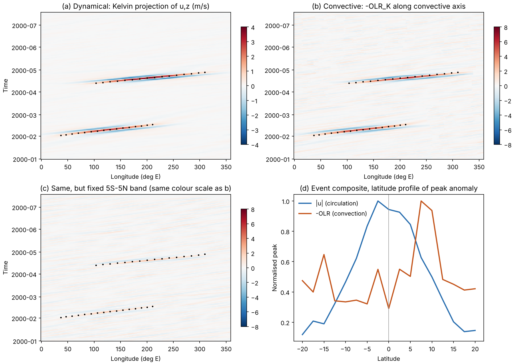

# M07 Kelvin 波事件识别:对流与动力双通道

## 对应代码

- `src/tropical_wave_tools/kelvin_events.py`
- `src/tropical_wave_tools/synthetic.py`(合成验证数据)
- `examples/kelvin_event_demo.py`
- `tests/test_kelvin_events.py`

## 要解决的问题

用 OLR 识别的对流耦合 Kelvin 波(CCKW)和用风场/位势高度识别的 Kelvin 波,在太平洋上经常不一致:对流包络位于 ITCZ(赤道以北几度),而环流响应在 `u`、`z` 上看起来大致关于赤道对称。如果仍用固定的赤道带(例如 5°S–5°N)平均去取对流信号,会低估甚至漏掉属于同一个波的对流。

本方法的思路是 **两个通道各自识别事件,再比较**,而不是把两者先合成一个指数:

| 通道 | 取样方式 | 回答的问题 |
|---|---|---|
| 动力通道 | `u`(和 `z`)在 Kelvin 经向结构 `psi_0(y)` 上投影 | 这里有没有一个 Kelvin 波 |
| 对流通道 | Kelvin 带 OLR 沿**随时间变化的对流轴纬度**高斯取样 | 这个波有没有对流伴随 |
| 耦合判据 | 沿波路径的滞后相关 + 替代样本显著性 | 对流是否与该波有统计意义上的锁相 |

事件分三类:`coupled`、`dynamical_only`、`convective_only`。

## 文献检索摘要

> 以下条目来自本次会话中的网络检索摘要。标注"已核实"的是检索结果直接给出的内容;标注"待核实"的是我凭记忆列出的方向,**引用前请查原文**。受网络白名单限制,本次未能打开 Yang et al. (2020) 与 Ogrosky & Stechmann (2016) 的 PDF 全文,所以公式细节和阈值没有对照原文逐条核对。

| 类别 | 方法 | 要点 | 状态 |
|---|---|---|---|
| 对流 | 频率-波数滤波 OLR(Wheeler & Kiladis 1999;Wheeler et al. 2000) | 在 Kelvin 色散曲线带内取 OLR;最传统的 CCKW 识别 | 已核实存在;常用波段:东传波数 2–14、周期 3–20 天(来自检索页对 WK99 的引用) |
| 动力 | 抛物柱函数投影(Yang, Hoskins & Slingo 2003, JAS) | 用 Matsuno 浅水解的经向结构把高、低层风场/位势投影到各波动模态,并与 OLR 结果比较,两套独立数据给出相互一致的结果 | 已核实 |
| 动力 | 2DS-PCF 实时版(Yang et al. 2021 / 2020 WAF 预印本) | 先用时间滤波分离东/西传,再做空间投影;预报开头拼接长分析期以支持宽时间窗滤波 | 已核实 |
| 动力 | 浅水本征向量投影(Ogrosky & Stechmann 2016) | 只用干变量(风、位势高度),不做时空滤波;Kelvin 波与滤波 OLR 吻合较好,Rossby 与 MRG 吻合一般 | 已核实 |
| 对流 | 谱聚焦时空 EOF 跟踪(Roundy & Schreck 2009;Roundy 2012, QJRMS) | 滤波 + 时间扩展 EOF,用于跟踪和预报对流耦合波 | 书目已核实,方法细节待核实 |
| 业务 | Wheeler–Weickmann 实时 OLR 滤波 | 实时识别、跟踪、预报 MJO 与赤道波;滤波前去除热带气旋信号(Schreck et al. 2011;Aiyyer et al. 2012) | 已核实(CICS-NC 监测页) |
| 平流层 | 三维跟踪算法(经度-高度-时间) | 把 Kelvin 波从对流层跟到平流层(JGR 2012);作者待核实 | 已核实存在 |
| 平流层 | 10–25 天东传纬向风滤波 | 平流层 Kelvin 波识别 | 已核实 |
| 对流 | ITCZ 内的 CCKW 个例(Straub & Kiladis 2002, JAS) | 东太平洋 ITCZ 中的 CCKW 个例,对流 15–20 m/s 东传,尺度约 3000 km | 已核实(摘要) |
| 对流 | 太平洋 CCKW 的位置偏好 | 检索结果提到 CCKW 最常出现在中太平洋 ITCZ 的南半球冬季 | 来源未能确认作者,待核实 |

### 一个需要你留意的反例

检索到的一份 NASA 托管手稿说:CCKW 合成风场在对流区有相当大的经向风分量,并称 Straub & Kiladis 研究的东太平洋波"有明显的反对称经向风结构"。**我没能核实这句话的原文**,但它提示:在 ITCZ 区域,`u` 与 `z` 可能近似赤道对称,而 `v` 并不对称。因此本方法没有把"风场对称"当作前提,而是把它做成每个事件的诊断量(`u_symmetry_index`、`v_to_u_ratio`),让数据自己回答。

## 为什么对流和动力识别会分歧

下面是物理推理,不是某篇文献的结论:

1. 线性浅水理论中,Kelvin 波的 `u`、`z` 是关于赤道的偶函数,`v=0`。
2. 对流加热 `Q` 不需要在赤道上也能激发 Kelvin 波,它激发的振幅正比于 `Q` 在 `psi_0` 上的投影(见下节)。
3. 对流若落在 8°N,它同时有一部分投影在反对称模态(MRG/Rossby 型)上,于是出现偏北的涡旋对和不对称的 `v`。

所以"对流偏北、`u` 近似对称"可以同时成立,但这不意味着对流和动力的识别会自动对齐:固定赤道带取样会把对流信号稀释,而 `v` 的反对称成分会污染没有做模态分离的风场指标。

## 方法

### 1. Kelvin 带滤波

沿用仓库已有的 `WaveFilter._kf_filter`(`kelvin_band_filter`),默认波数 2–14、周期 3–20 天、等效深度 8–90 m。输入先去除季节循环(前 3 个谐波)。

### 2. 动力通道:Kelvin 经向投影

取无量纲坐标 `y -> y / Ld`,`Ld = sqrt(c/beta)`,`c = sqrt(g He)`。Matsuno 变量 `q = u + phi/c`。浅水方程中 `q` 满足

```text
(d/dt + c d/dx) q + c (d/dy - y/Ld^2) v = (热源项)
```

把它投影到 `psi_0(y) = exp(-y^2 / 2 Ld^2)` 上。因为 `d(psi_0)/dy = -(y/Ld^2) psi_0`,分部积分后 `v` 项恒为零:

```text
∫ psi_0 (d/dy - y/Ld^2) v dy = -∫ v (d psi_0/dy + (y/Ld^2) psi_0) dy = 0
```

因此

```text
K(x, t) = ∫ q psi_0 dy / ∫ psi_0^2 dy
```

在线性理论下严格是 Kelvin 振幅:它只以速度 `c` 东传,不受 `v` 和任何其他模态污染。离散实现用 `sum(F psi w) / sum(psi^2 w)`,在纬度带截断时仍能精确还原 `F = A psi_0`(测试 `test_projection_recovers_amplitude_on_truncated_band`)。反对称场与 `psi_0` 正交,投影为零(测试 `test_projection_is_orthogonal_to_antisymmetric_structure`)。

默认 `He = 25 m`(`c ≈ 15.7 m/s`,`Ld ≈ 7.4°`)。不给 `z` 时退化为只投影 `u`。

### 3. 对流通道:沿对流轴取样

对流通道的关键是**不固定纬度**:

- 对流轴纬度 = Kelvin 带 OLR 方差最大处的纬度(时间滑动窗 91 天、经向平滑 20°,抛物线插值到网格以下,再做经向中值滤波),函数 `convective_axis_latitude`;
- 对流指数 = `-OLR_K` 以该纬度为中心、宽度 5° 的高斯加权平均,函数 `convective_kelvin_index`;
- 同时保留固定 5°S–5°N 带指数(`fixed_band_convective_index`)作对照。

如果你有更好的 ITCZ 位置来源(例如降水气候态),可以通过 `axis_lat=` 直接传入。

偏离赤道的高斯热源在 Kelvin 模态上的投影系数(以 `Ld` 为单位,热源宽度 `sigma`,偏离 `y0`)为

```text
A(y0) / A(0) = exp( -y0^2 / (2 (1 + sigma^2)) )
```

已用数值验证。例如 8°N、`sigma = 3°` 时约为 0.61,也就是说 8°N 的对流仍能强迫出约 60% 的 Kelvin 响应。这个数字也可用来判断偏北对流是否足以解释动力通道观测到的振幅。

### 4. 事件追踪

两个通道的指数都是 `(时间, 经度)` 场,用同一个追踪器 `detect_propagating_ridges`:

1. 每个时刻找经度方向的局部极大(周期边界,抛物线细化)。
2. 把脊线逐步链接到下一时刻:东传位移不超过最大相速的 1.3 倍,在候选中选与轨迹自身近期速度最接近的,一对一贪心匹配,允许空缺 `max_gap_steps`。
3. 滞回阈值:轨迹在 `continue_sigma` 之上可继续,至少一次超过 `peak_sigma`。
4. 保留:寿命 ≥ 4 天,东传距离 ≥ 40°,线性拟合相速在 8–30 m/s。
5. 可选绝对振幅阈值 `dyn_min_amplitude`、`conv_min_amplitude`。

### 5. 耦合判据

对每个动力事件,沿其拟合路径取 `K(t, x_path)`,与对流指数在 ±30° 经度偏移内逐一取相关,取最大值 `coupling_corr`,对应偏移记为 `conv_offset_deg`(正值表示对流在风场脊以东)。

沿路径的点数很少(4–10 个),在 25 个偏移里取最大值会明显偏高,纯噪声也常超过 0.5。所以同时用 **替代样本** 估计 p 值:把对流指数沿时间循环平移 15 天以上(破坏相位关系,保留空间结构与噪声特性),重复同样的最大相关统计,

```text
p = (1 + #{替代样本 >= 观测}) / (1 + N),   N = 40
```

`coupled` 要求 `coupling_corr >= 0.5` 且 `p <= 0.05`。这个检验是测试发现问题之后加上的(见下方"验证状态")。

动力事件的诊断量:

- `u_symmetry_index`:事件邻域内 `u` 的对称/反对称能量对比,`+1` 为纯对称。
- `v_to_u_ratio`:邻域内 `rms(v)/rms(u)`,Kelvin 波应当很小。
- `conv_axis_lat`:该事件对流所在的轴纬度。
- `conv_peak` 与 `conv_peak_fixed_band`:同一路径上轴取样与固定带取样的对流峰值,二者之比直接量化固定带造成的损失。

对流通道里没有与任何动力事件在时空上重叠(重叠 ≥ 50% 且平均经度差 ≤ 40°)的脊线标为 `convective_only`。

## 使用

```python
import tropical_wave_tools as twt

cfg = twt.KelvinEventConfig(
    peak_sigma=1.5, continue_sigma=0.75,
    dyn_min_amplitude=1.0,      # m/s, 按你的层次调整
    conv_min_amplitude=8.0,     # W m-2
    axis_lat_range=(0.0, 15.0), # 只看 ITCZ 一支,避免和 SPCZ 之间跳变
)
catalog = twt.identify_kelvin_events(u=u850, z=z850, v=v850, olr=olr, config=cfg)

catalog.events      # 每个事件一行,含 kind / 速度 / 耦合 / 对称性
catalog.tracks      # 每个事件的逐日脊线位置
catalog.indices     # 动力指数、对流指数、对流轴纬度
catalog.save("outputs/kelvin")

# 以动力峰值为参考的随波合成
comp_u = twt.event_composite(u850_anom, catalog.events, kinds=("coupled",))
comp_olr = twt.event_composite(olr_anom, catalog.events, kinds=("coupled",))
```

命令行:

```bash
tropical-wave-tools kelvin-events \
  --olr data/local/olr.day.mean.nc \
  --u data/local/u850.nc --z data/local/z850.nc --v data/local/v850.nc \
  --time-start 1998-01-01 --time-end 2017-12-31 \
  --dyn-min-amplitude 1.0 --conv-min-amplitude 8 \
  --output-dir outputs/kelvin
```

可复现的合成示例与示意图:

```bash
PYTHONPATH=src python examples/kelvin_event_demo.py docs/assets/kelvin_events_demo.png
```



图为**合成数据**(风场对称、对流在 8°N):(a) 动力投影;(b) 沿对流轴的对流指数;(c) 固定 5°S–5°N 带,色标与 (b) 相同,信号明显被稀释;(d) 事件合成的纬向峰值剖面。

### 输出字段

| 字段 | 含义 |
|---|---|
| `kind` | `coupled` / `dynamical_only` / `convective_only`(无风场时为 `convective`) |
| `start_time`, `end_time`, `peak_time` | 事件时间 |
| `lon_start`, `lon_end`, `lon_peak` | 经度(度E) |
| `speed_ms` | 线性拟合相速 |
| `peak_sigma`, `peak_amp` | 峰值(标准差单位和原单位) |
| `coupling_corr`, `coupling_pvalue` | 最大滞后相关与替代样本 p 值 |
| `conv_offset_deg` | 对流相对风场脊的经度偏移 |
| `conv_axis_lat` | 对流轴纬度 |
| `conv_peak`, `conv_peak_fixed_band` | 轴取样 / 固定带取样的对流峰值 |
| `u_symmetry_index`, `v_to_u_ratio` | 风场对称性与 Kelvin 纯度 |
| `matched_event` | 与之匹配的对流脊线 ID |

## ERA5 850 hPa、太平洋、2000–2020 工作流

**不能只读太平洋一块数据。** Kelvin 滤波需要完整的纬向波数,追踪需要周期边界,区域数据会被 `identify_kelvin_events` 以 `ValueError` 拒绝。正确做法是全球经度计算,再用 `--region-lon` 只统计穿过太平洋的事件(默认 `120 280`,即 120°E–80°W;事件的脊线在窗口内至少停留 3 天才算,可用 `--min-region-points` 调整,支持跨 0° 的窗口)。

数据准备(下载后自行转换,仓库不含 ERA5 数据,也没有 CDS 下载代码):

| 变量 | 要求 | 常见陷阱 |
|---|---|---|
| `u`、`v` | 850 hPa,日平均,m/s,**全球经度** | 小时数据会被自动平均为日值 |
| `z` | 850 hPa | ERA5 的 `z` 是**位势**(m² s⁻²),必须加 `--z-geopotential` 除以 g,否则 `z` 项会被放大约 10 倍 |
| OLR | W m⁻² | ERA5 的 `ttr` 是累积量、符号为负,需要 `--olr-factor`(小时累积为 `-1/3600`);累积口径请对照 ECMWF 文档确认,这里没有验证。也可以用 NOAA 插值 OLR |
| 网格 | 0.25° 全球 20 年日数据每个变量约 14 GB | 用 `--regrid-deg 2.5` 先块平均再插值到对赤道对称的 2.5° 网格 |

```bash
tropical-wave-tools kelvin-events \
  --u era5_u850.nc --z era5_z850.nc --v era5_v850.nc \
  --olr olr.day.mean.nc --olr-var olr \
  --level 850 --regrid-deg 2.5 --z-geopotential \
  --time-start 2000-01-01 --time-end 2020-12-31 --buffer-days 30 \
  --region-lon 120 280 \
  --dyn-min-amplitude 1.0 --conv-min-amplitude 8 \
  --output-dir outputs/kelvin_pacific
```

要点:

- 窗口两端各多读 `--buffer-days` 天,事件按 `peak_time` 再裁回 2000–2020,避免滤波边缘效应。
- **不要把 `--axis-lat-min` 设成 0。** 早先版本建议过这个设置,但它会让南侧对流的波被误判为 `dynamical_only`,并且把 `conv_axis_lat` 报成北纬(见下节"偏差检验")。默认的 `-15 20` 更安全;事件的对流纬度请看 `conv_peak_lat`,不要看 `conv_axis_lat`。
- **NOAA 插值 OLR**:2.5° 日平均、全球经度,不需要 `--regrid-deg` 也不需要 `--olr-factor`;ERA5 风场用 `--regrid-deg 2.5` 之后两者就在同一网格上。网格或经纬度不一致会直接报错,时间取公共时段。OLR 中的缺测会按 0 异常处理(只影响很少的格点)。
- **降水**:同一流程也能用降水(如 GPCP、IMERG)。降水大值对应强对流,与 OLR 符号相反,传入时加 `--olr-factor -1`,此时 `--conv-min-amplitude` 的单位是 mm/day,阈值要重新选。
- 阈值请先看敏感性:`event_count_sensitivity(catalog.indices["kelvin_dynamical"])`。`--dyn-min-amplitude 1.0`、`--conv-min-amplitude 8` 只是起点,不是经过检验的推荐值。

输出:`events.csv`、`tracks.csv`、`indices.nc`、`summary.csv`(按 kind × 季节的事件数、中位速度、中位 `conv_axis_lat`、`u_symmetry_index`、`v_to_u_ratio`、轴/固定带峰值比),`structure_summary.csv`、`conv_profiles.csv`,以及 `kelvin_region_report.png`(`u`、`v`、`-OLR` 随波合成图,峰值剖面,对流峰值纬度与 `u` 对称指数分布)和 `kelvin_structure_report.png`(见下节)。

**读结果时回答你的问题:**

1. `coupled` 事件的 `median_conv_peak_lat` 是否明显大于 0,`structure_summary.csv` 里 `frac_northern` 是多少?
2. 同一批事件的 `median_u_symmetry_index` 是否接近 1?
3. `median_v_to_u_ratio` 是否很小?如果不小,说明 `v` 并不对称/并非纯 Kelvin,风场"对称"只对 `u`、`z` 成立。
4. `median_peak_ratio_axis_over_fixed` 是否明显大于 1?这是固定赤道带少看到多少对流的直接度量。
5. 分季节看(DJF/JJA),ITCZ 位置随季节变,结论可能不同。

合成数据的压力测试(21 年日数据、2.5°、17 个纬度、150 个注入事件):约 34 秒、峰值内存约 2.6 GB。

## 对流是否"都在赤道以北"?事件级结构诊断

**不能用 `conv_axis_lat` 回答这个问题。** 它是周围 91 天里 Kelvin 带 OLR 方差最大处的纬度,用来决定在哪里取样,受 `axis_lat_range` 限制,不是对某个事件的测量。对流轴指数是以该纬度为中心的高斯,也天然适合偏离赤道的单峰,对赤道上的对称对流和镜像双峰没有诊断能力。

所以每个事件另外计算一个**不依赖任何纬度假设**的对流经向剖面:

1. 用 ±`structure_lat_max`(默认 15°)宽带平均的 `-OLR_K` 找出风场脊与对流之间的经度偏移(宽带指数不含纬度假设);
2. 沿事件路径取各纬度的 `-OLR_K`,按风场脊的强度加权平均,得到该事件的剖面(`catalog.conv_profiles`);
3. 从剖面算出:

| 字段 | 含义 |
|---|---|
| `conv_peak_lat` | 剖面峰值纬度(抛物线插值) |
| `conv_symmetry_index` | 关于赤道的对称指数,+1 为完全对称(只用增强对流的正值部分) |
| `conv_nh_fraction` | 北半球占增强对流能量的份额(0.5 为南北均分) |
| `conv_eq_fraction` | ±5° 内的能量占比 |
| `struct_peak` | 剖面峰值(`-OLR_K` 单位) |
| `conv_structure` | 分类,见下 |

分类规则(启发式,阈值在 `KelvinEventConfig` 的 `structure_*` 参数里,请看分布而不要只看类别):

- `weak`:剖面峰值 < `structure_min_peak`(默认 3 W m⁻²),没有清晰的对流信号;
- `equatorial`:对称指数 ≥ 0.5 且峰值在赤道 ±5° 内;
- `symmetric_off_equator`:对称指数 ≥ 0.5 但峰值离赤道较远,即镜像双峰(类似双 ITCZ);
- `northern` / `southern`:不对称,按半球能量份额分。

`run_regional_workflow` 和 CLI 会输出 `structure_summary.csv`(按 kind × 季节的各类数量与占比)、`conv_profiles.csv`,以及 `kelvin_structure_report.png`(逐事件剖面热图、峰值纬度直方图、风场对称性对比对流对称性的散点、分季节的类别占比)。

**读法**:如果太平洋 Kelvin 波的对流"全部偏北",应当看到 `frac_northern` 接近 1、`conv_peak_lat` 集中在正值,并且 `conv_symmetry_index` 普遍很低;只要有可观的 `equatorial`、`symmetric_off_equator` 或 `southern` 比例,就说明不是全部偏北。同时对照 `u_symmetry_index` 和 `v_to_u_ratio`,判断风场是否同样对称。

### 偏差检验(合成数据)

用上一版建议的 `axis_lat_range=(0, 15)` 在合成数据里注入了南侧对流(−8°)的波:旧版判据把它判成 `dynamical_only`(`p=0.63`),并报告 `conv_axis_lat=+8.8`。现在 `coupled` 取"轴指数或宽带指数任一通过",该事件为 `coupled`,结构诊断给出 `conv_peak_lat=-8.2`、`southern`。

21 年日数据规模的合成数据里随机注入 160 个事件(北 40%、赤道 20%、南 20%、对称双峰 20%,对流经度偏移随机),识别出 136 个动力事件(`coupled` 129、`dynamical_only` 7),结构分类的结果:

- 非弱信号事件总体准确率约 95%;
- 孤立事件(10 天、60° 内没有别的注入波)准确率约 98%;
- 9 个错分里有 7 个出现在多个波时空重叠的情形,剖面被混合;其余 2 个是信噪比低的孤立事件。

这些数字依赖合成设定(对流宽度 3°、振幅、噪声水平),**不代表真实资料中的准确率**。真实 OLR 的 Kelvin 带对流常常是几个云团的混合,剖面更宽、更不规则,分类阈值很可能需要调整。

## 参数建议

- **阈值是最主要的调参旋钮。** 相对阈值(σ)在没有真实波动的记录里仍然会放进噪声脊线;请同时设绝对振幅阈值,并先看 `event_count_sensitivity(index, peak_sigmas=(1, 1.5, 2, 3))`:事件数在一段阈值范围内几乎不变的"平台"才是稳健的选择。
- **`projection_depth`**:25 m 是起点。在 8–90 m 内改变它,检查事件集是否稳定。
- **`axis_lat_range`**:在西太平洋,ITCZ 与 SPCZ 之间的方差最大值可能来回跳。限定为 `(0, 15)` 或传入外部 `axis_lat`。
- **`conv_width_deg`**:5° 为起点,不要比对流带实际宽度窄太多。
- **纬度范围**:风场至少覆盖 ±15°,且上下对称(对称性诊断要求网格关于赤道对称)。
- 经度必须是**全球等间距网格**,区域数据会被拒绝。

## 验证状态与局限

**已验证(合成数据,`tests/test_kelvin_events.py`)**

- 投影精确还原振幅、对反对称结构正交。
- 注入 2 个 Kelvin 波包(风场对称、对流在 8°N)与 2 个干扰(西传对称波包、东传反对称波包)后,事件数恰为 2,相速误差 ≤ 2 m/s,对流轴纬度 ≈ 8°N,`u_symmetry_index > 0.9`,`v_to_u_ratio < 0.15`。
- 对 12 个随机种子重复:12/12 恰好识别 2 个事件、0 个多余事件、2 个都判为 `coupled`。
- 干对照(强风波 + 纯噪声 OLR)12 次中 0 次被误判为 `coupled`。
- 在合成设定下,固定 5°S–5°N 带的峰值只有对流轴取样的约 35–40%,并在同样的绝对阈值下 12/12 次漏检。**这是设定(对流中心 8°N、宽 3°)的直接后果,说明机理,不是对真实数据的结论。**

**发现并修复的问题**:最初只用"最大滞后相关 ≥ 0.5"做耦合判据时,纯噪声也经常通过(路径点数少、偏移多);加入替代样本 p 值后消除。相对阈值在无真实波动的记录里也会放进噪声脊线,所以增加了绝对振幅阈值。

**尚未验证 / 已知局限**

- **没有真实风场数据测试。** 本仓库仅含一年 OLR 样例,只对对流通道做了冒烟测试(能运行、速度落在范围内),以及与仓库 `filter_wave_signal` 滤波结果的一致性检查。动力通道和耦合判据只在合成数据上验证过,**真实再分析上的表现、默认阈值是否合适,都需要你用 ERA5 等数据检验。**
- 单一气压层的 `u` 与 `z` 并不严格满足某个垂直模态的 `u = phi/c` 关系;精确的模态分离需要先做垂直模态分解。`z` 缺失时只投影 `u`,会有来自对称 EIG(n=1) 等模态的少量污染。
- 对流轴按 Kelvin 带 OLR 方差定义,如果某个季节没有 Kelvin 带对流,轴纬度没有意义(此时对流通道的事件也不应被信任)。
- 热带气旋信号会进入 OLR Kelvin 带(业务滤波通常会预先去除),本实现没有处理。
- 滤波前后各约一个窗口长度内有边缘效应(去趋势与 Tukey 锥形窗),请不要解读记录首尾的事件。
- 耦合判据测量的是锁相相关,不是因果。`dynamical_only` 既可能是"干 Kelvin 波",也可能是对流指数质量不够。

## 建议的真实数据检验计划

1. ERA5 `u850`、`z850`(或 `v850`)与 NOAA 插值 OLR 同期,先选太平洋 130°E–120°W 与印度洋各一个区域。
2. 把 `catalog.events` 与 Wheeler–Kiladis Kelvin 滤波 OLR 的固定带事件对照,统计"只有轴取样才找到"的事件比例及其 `conv_axis_lat` 分布。
3. 对 `projection_depth`、`conv_width_deg`、`peak_sigma` 做敏感性扫描。
4. 用 `event_composite` 画 `u`、`v`、OLR 的随波合成,直接检查"`u` 对称、对流偏北"是否成立,以及 `v` 是否反对称。
5. 分季节(DJF/JJA)重复。

## 参考文献与链接

- Yang, G.-Y., B. Hoskins, and J. Slingo, 2003: Convectively coupled equatorial waves: A new methodology for identifying wave structures in observational data. *J. Atmos. Sci.* [Reading CentAUR](https://centaur.reading.ac.uk/748/)
- Yang, G.-Y., et al., 2020/2021: 实时 2DS-PCF 投影,*Weather and Forecasting*。[预印本](https://reading-9.eprints-hosting.org/94722/1/Yang_et_al_2020_WAF_accepted.pdf)
- Ogrosky, H. R., and S. N. Stechmann, 2016: 基于浅水本征向量的干变量波动识别。[PDF](https://people.math.wisc.edu/~stechmann/publications/OgroskyStechmann2016.pdf)
- Straub, K. H., and G. N. Kiladis, 2002: Observations of a convectively coupled Kelvin wave in the eastern Pacific ITCZ. *J. Atmos. Sci.*, 59, 30–53. [EOL](https://www.eol.ucar.edu/publications/observations-convectively-coupled-kelvin-wave-eastern-pacific-itcz)
- 关于东太平洋 CCKW 经向风反对称结构的说法(未核实原文):[NASA NTRS 手稿](https://ntrs.nasa.gov/api/citations/20070016555/downloads/20070016555.pdf)
- Roundy, P. E., and W. M. Frank, 2004: A climatology of waves in the equatorial region. *J. Atmos. Sci.*, 61, 2105–2132.
- Roundy, P. E., 2012: Tracking and prediction of large-scale organized tropical convection by spectrally focused two-step space-time EOF analysis. *Q. J. R. Meteorol. Soc.*, 138, 919–931.
- Wheeler, M., and G. N. Kiladis, 1999: Convectively coupled equatorial waves: Analysis of clouds and temperature in the wavenumber–frequency domain. *J. Atmos. Sci.*(波段定义)
- Tracking Kelvin waves from the equatorial troposphere into the stratosphere, *J. Geophys. Res.*, 2012. [Princeton](https://fueglistaler.princeton.edu/publications/tracking-kelvin-waves-equatorial-troposphere-stratosphere)
- `easyclimate` 的 2D 空间 PCF 滤波实现(可作为交叉检验):[文档](https://easyclimate.readthedocs.io/en/latest/auto_gallery/filter/plot_spatial_pcf.html)
- Wheeler–Weickmann 实时 OLR 滤波监测:[CICS-NC](https://ncics.org/mjo/)

待核实的方向(凭记忆,未在本次检索中确认原文):Kiladis et al. (2009, *Rev. Geophys.*) 综述;Schreck 与 Molinari 关于 Kelvin 波与热带气旋生成的客观识别标准;Straub & Kiladis (2003) 对 CCKW 结构与简单耦合模型的比较。
